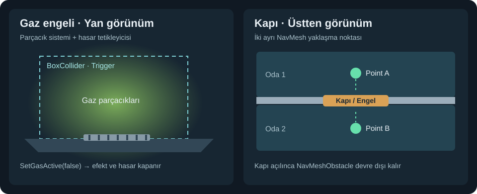
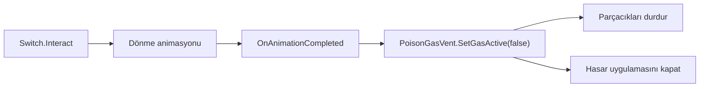
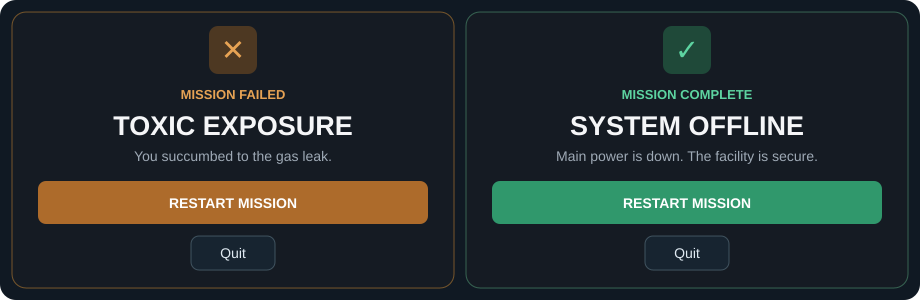

# Dünya nesneleri ve oyun akışı

[README](../README.md) · [Main sahnesi](../Assets/_Project/Scenes/Main.unity) · [Prefab klasörü](../Assets/_Project/Prefabs/) · [Robot](robot.md) · [Muhafız](muhafiz.md)

## Gaz ve şalter

[PoisonGasVent](../Assets/_Project/Scripts/PoisonGasVent.cs) parçacık sistemlerini ve hasar durumunu `SetGasActive()` ile birlikte yönetir. [PoisonGasDamageZone](../Assets/_Project/Scripts/PoisonGasDamageZone.cs), etkin tetikleyicinin içinde `PlayerHealth` bulursa fizik adımı başına `damagePerSecond × fixedDeltaTime` kadar hasar uygular. Bakım robotu bu oyuncu sağlığı bileşenini taşımadığı için şaltere ulaşabilir.

[Switch](../Assets/_Project/Scripts/Switch.cs) etkileşim geldiğinde açma veya kapatma animasyonunu başlatır. `OnAnimationCompleted()` yeni durumu uygular ve bağlı gaz vanasını günceller. `GameFlowManager.SelectGasSwitch()`, aday listesi atanırsa bir gaz şalterini etkinleştirir, diğerlerini gizler ve vanayı seçilen adaya bağlar. Final şalteri ayrıdır.

## Kapı ve kilit

[DoorInteractable](../Assets/_Project/Scripts/DoorInteractable.cs) kapı animasyonunu, etkileşimi ve `NavMeshObstacle` bileşenini yönetir. A ve B noktaları kapının iki tarafından yaklaşılabilmesini sağlar. Robot yakın noktayı önce dener. NavMesh yolu yoksa diğer noktayı dener. Normal kapı açıldığında engel bileşeni devre dışı kalır.

[Lock](../Assets/_Project/Scripts/Lock.cs) muhafız kapısının kilit durumunu saklar. Kilitliyken normal etkileşim reddedilir ve robot kapıyı hedeflemez. Muhafızın doğrulanmış kararı `UnlockAndOpen()` ile kilidi kaldırıp animasyonu başlatır.

## Oyun sonu ve menüler

[GameFlowManager](../Assets/_Project/Scripts/GameFlowManager.cs) görev başlatmayı, duraklatmayı ve son durumu yönetir. Final şalterinin açık durumdan kapalı duruma geçtiğini izler. [GameEndUI](../Assets/_Project/Scripts/UI/GameEndUI.cs) sonuca göre görev başarısı veya ölüm ekranını gösterir. [MissionUI](../Assets/_Project/Scripts/UI/MissionUI.cs) başlangıç menüsü, Escape, Resume, Quit ve model ayarlarını bağlar.

Bu çizim, mevcut arayüz metinleri ve USS renkleriyle hazırlanmış rapor gösterimidir. Test ölçümleri [README testlerinde](../README.md#6-testler).
