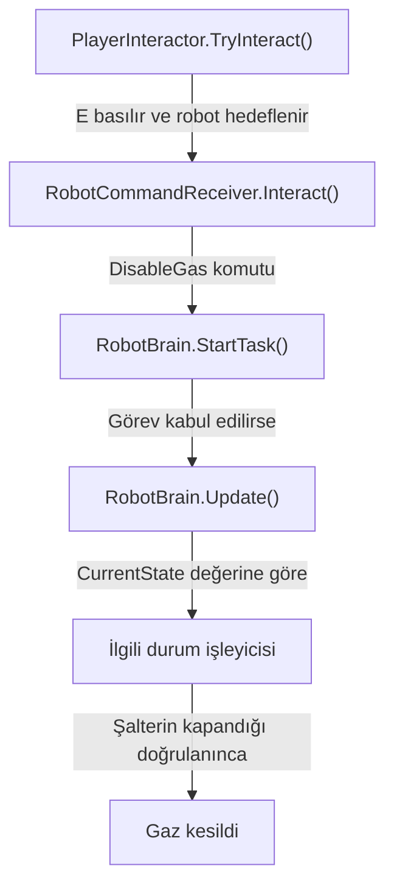
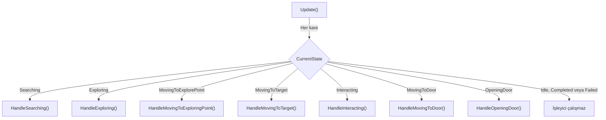
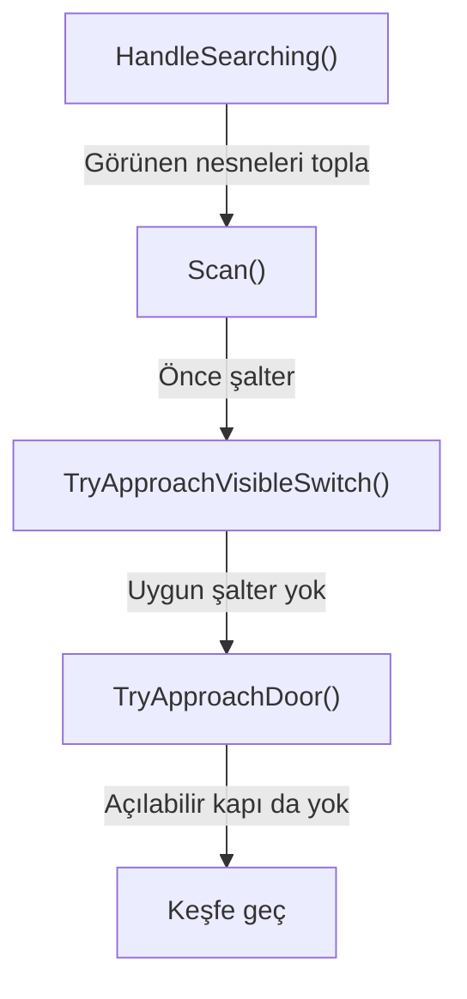
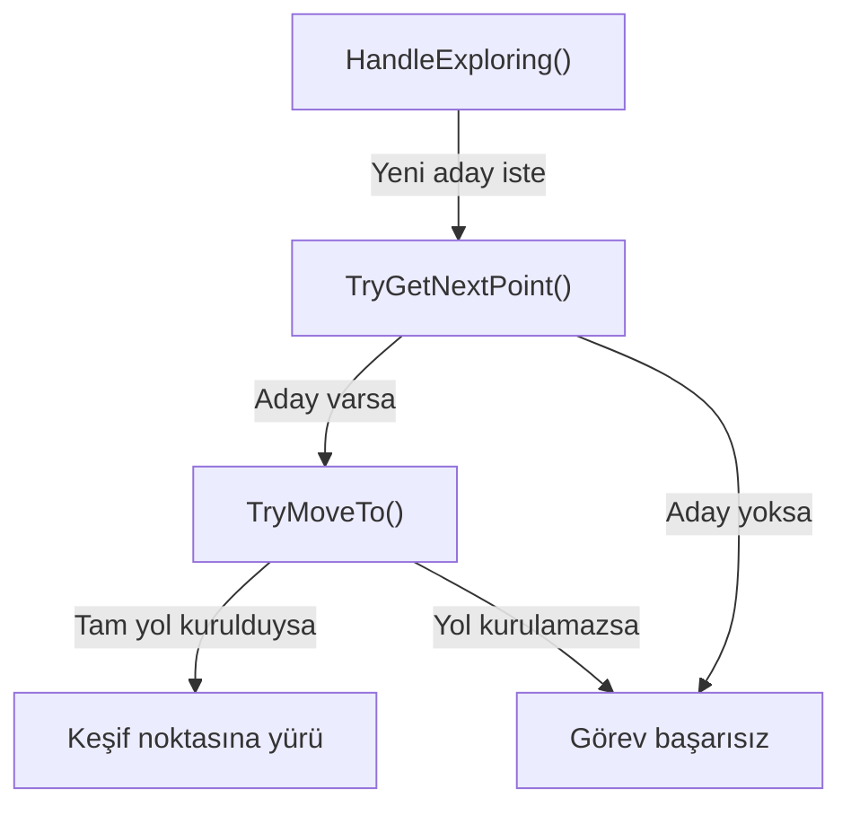
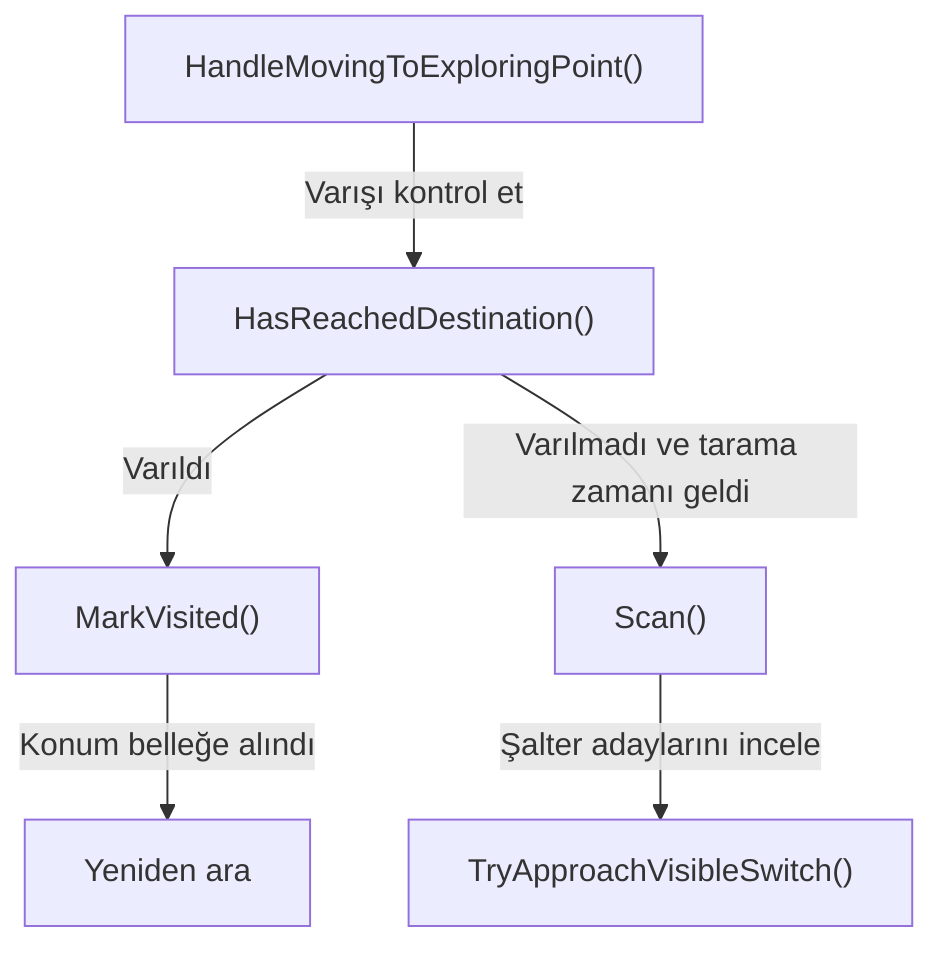
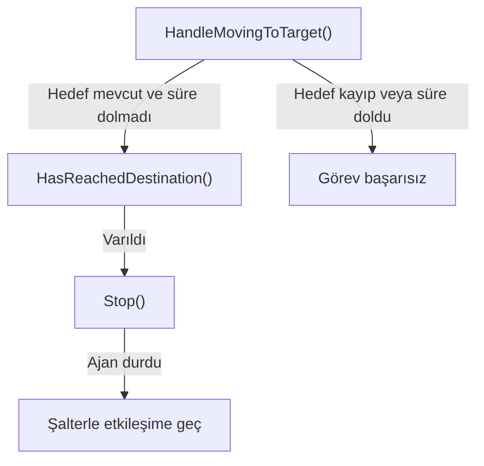
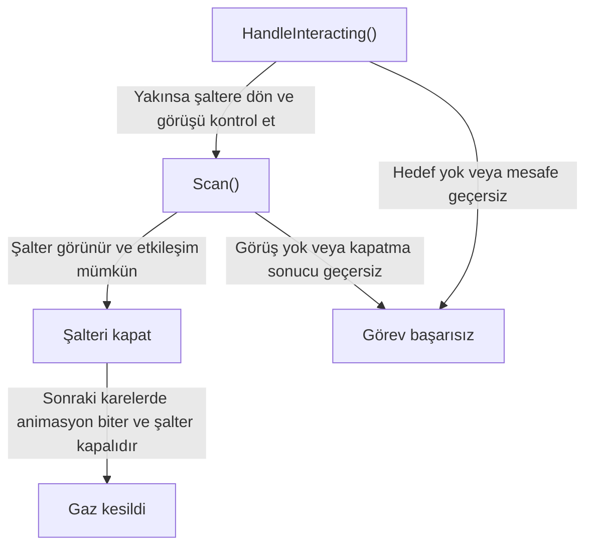
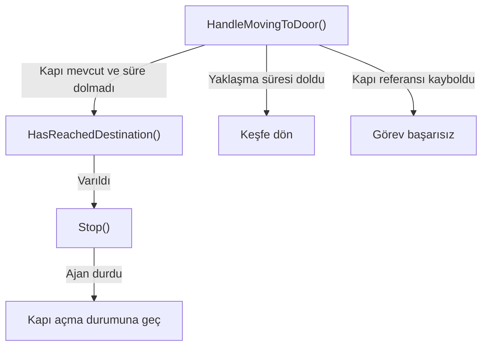
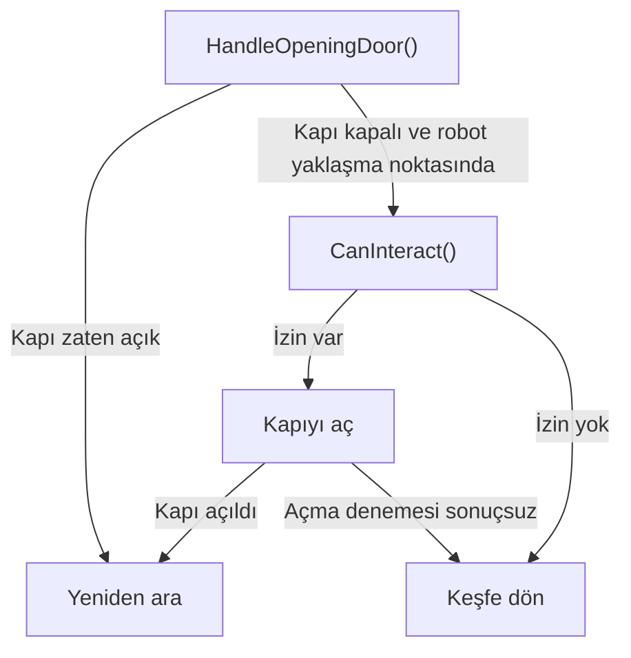

# Bakım robotu modülü

[README](../README.md) · [Robot kaynak klasörü](../Assets/_Project/Scripts/Robot/) · [Robot prefabı](../Assets/_Project/Prefabs/PF_Robot.prefab) · [Muhafız](muhafiz.md) · [Dünya ve oyun akışı](oyun-akisi.md)

Oyuncu robota gazı kesme görevi verir. Robot sensörlerinden bilgi toplar, keşif hedefi seçer ve NavMesh üzerinden hareket eder. Görev şalterin kapandığı doğrulandığında tamamlanır.

| Alt modül | Dosya ve fonksiyonlar | Neden ayrı? |
| --- | --- | --- |
| Komut | [RobotCommandReceiver](../Assets/_Project/Scripts/Robot/RobotCommandReceiver.cs) · `Interact()` | Oyuncu girdisini `DisableGas` görevine dönüştürür. |
| Karar | [RobotBrain](../Assets/_Project/Scripts/Robot/RobotBrain.cs) · `StartTask()`, `HandleSearching()`, `TryApproachVisibleSwitch()` | Şalter, normal kapı ve keşif kararlarının sırasını yönetir. |
| Algı | [RobotSensor](../Assets/_Project/Scripts/Robot/RobotSensor.cs) · `Scan()`, `ScanEnvironment()` | Fizik ölçümlerini üretir. [EnvironmentRayReading](../Assets/_Project/Scripts/Robot/EnvironmentRayReading.cs) tek ışının sonucunu taşır. |
| Keşif | [RobotExplorer](../Assets/_Project/Scripts/Robot/RobotExplorer.cs) · `TryGetNextPoint()`, `AddFrontier()`, `MarkVisited()` | Son taramayı ve önceki durakları kullanarak bir sonraki keşif noktasını seçer. |
| Hareket | [RobotNavigation](../Assets/_Project/Scripts/Robot/RobotNavigation.cs) · `CanReach()`, `TryGetPathLength()`, `TryMoveNear()`, `TryMoveTo()` | NavMesh sorgularını ve ajan hareketini kapsüller. |

## RobotBrain

Oyuncunun komutu `StartTask(DisableGas)` ile başlar. `Update()` her karede `CurrentState` üzerinden bir işleyici seçer. Ok üzerindeki durum, çalıştırılan fonksiyonu belirler. Şemanın altındaki fonksiyon bağlantıları açıklamaya götürür.

### Update karar şeması

**İşleyicinin içine bak:** [`HandleSearching()`](#handlesearching) · [`HandleExploring()`](#handleexploring) · [`HandleMovingToExploringPoint()`](#handlemovingtoexploringpoint) · [`HandleMovingToTarget()`](#handlemovingtotarget) · [`HandleInteracting()`](#handleinteracting) · [`HandleMovingToDoor()`](#handlemovingtodoor) · [`HandleOpeningDoor()`](#handleopeningdoor)

[Update() kaynak kodu](../Assets/_Project/Scripts/Robot/RobotBrain.cs#L69) · [README’deki durum geçişleri](../README.md#robotbrain--sonlu-durum-makinesi)

`Idle`, `Completed` ve `Failed` için bu `switch` içinde ayrı bir dal yoktur.

#### HandleSearching

Görünen nesneleri tarar. Önce gaz şalterini dener. Uygun şalter yoksa açılabilir normal kapıları kontrol eder. İkisi de sonuç vermezse Exploring durumuna geçer.

[Kaynak kodu](../Assets/_Project/Scripts/Robot/RobotBrain.cs#L168) · [Scan](#nesne-taraması) · [Şalter ve kapıya yaklaşma](#alt-çağrılar) · [Karar şemasına dön](#update-karar-şeması)

#### HandleExploring

Yeni bir keşif hedefi ister ve NavMesh rotasını ajana verir. Aday veya tam yol bulunmazsa Failed, hareket başlarsa MovingToExplorePoint.

[Kaynak kodu](../Assets/_Project/Scripts/Robot/RobotBrain.cs#L220) · [TryGetNextPoint ve yol seçimi](#keşif-ve-rota) · [Karar şemasına dön](#update-karar-şeması)

#### HandleMovingToExploringPoint

Hedefe vardıysa durur, konumu kaydeder ve Searching durumuna döner. Henüz varmadıysa yaklaşık 0,3 oyun saniyesinde bir şalter tarar. Uygun şalter bulursa keşif rotasını bırakabilir.

[Kaynak kodu](../Assets/_Project/Scripts/Robot/RobotBrain.cs#L239) · [MarkVisited](#ziyaret-belleği) · [Scan](#nesne-taraması) · [Karar şemasına dön](#update-karar-şeması)

#### HandleMovingToTarget

Şaltere doğru hareketi izler. Hedef kaybolursa veya süre dolarsa Failed olur. Ulaşınca ajanı durdurup Interacting durumuna geçer.

[Kaynak kodu](../Assets/_Project/Scripts/Robot/RobotBrain.cs#L263) · [HasReachedDestination](../Assets/_Project/Scripts/Robot/RobotNavigation.cs#L72) · [Karar şemasına dön](#update-karar-şeması)

#### HandleInteracting

Şaltere olan mesafeyi kontrol eder, şaltere dönüp görüşü yeniden doğrular. Şalteri bir kez tetikler ve hareketi bitene kadar bekler. Kapalı sonuç Completed, açık sonuç Failed olur.

[Kaynak kodu](../Assets/_Project/Scripts/Robot/RobotBrain.cs#L293) · [Scan](#nesne-taraması) · [Switch.Interact](../Assets/_Project/Scripts/Switch.cs#L53) · [Karar şemasına dön](#update-karar-şeması)

#### HandleMovingToDoor

Kapının yaklaşma noktasına varılmasını bekler. Varınca OpeningDoor durumuna geçer. Yaklaşma süresi dolarsa keşfe döner. Kapı referansı kaybolursa görev başarısız olur.

[Kaynak kodu](../Assets/_Project/Scripts/Robot/RobotBrain.cs#L355) · [Kapıya yaklaşma](#alt-çağrılar) · [HasReachedDestination](../Assets/_Project/Scripts/Robot/RobotNavigation.cs#L72) · [Karar şemasına dön](#update-karar-şeması)

#### HandleOpeningDoor

Kapı açıldıysa yeniden arar. Kapı kapalıysa mesafeyi ve etkileşim iznini kontrol edip açma isteği gönderir. Animasyon sürerken bekler. Açma denemesi sonuç vermezse keşfe döner.

[Kaynak kodu](../Assets/_Project/Scripts/Robot/RobotBrain.cs#L388) · [Kapı ve kilit](oyun-akisi.md#kapı-ve-kilit) · [Karar şemasına dön](#update-karar-şeması)

### Alt çağrılar

- **Şalter yaklaşımı.** [`TryApproachVisibleSwitch()`](../Assets/_Project/Scripts/Robot/RobotBrain.cs#L120) → [`TryMoveNear()`](../Assets/_Project/Scripts/Robot/RobotNavigation.cs#L57) → [`TryMoveTo()`](../Assets/_Project/Scripts/Robot/RobotNavigation.cs#L28) → [`CanReach()`](../Assets/_Project/Scripts/Robot/RobotNavigation.cs#L16). Yaklaşma noktası NavMesh'e örneklenir. Şalter yakınsa yürüyüş adımı atlanır.
- **Kapı yaklaşımı.** [`TryApproachDoor()`](../Assets/_Project/Scripts/Robot/RobotBrain.cs#L449) → [`TryMoveNear()`](../Assets/_Project/Scripts/Robot/RobotNavigation.cs#L57) → [`TryMoveTo()`](../Assets/_Project/Scripts/Robot/RobotNavigation.cs#L28). A ve B noktalarından yakını önce denenir. Robot zaten yaklaşma noktasındaysa yol kurulabilirliğini kontrol edip doğrudan açma durumuna geçebilir.
- **Keşif hedefi.** [`TryGetNextPoint()`](../Assets/_Project/Scripts/Robot/RobotExplorer.cs#L33) önce [`ScanEnvironment()`](../Assets/_Project/Scripts/Robot/RobotSensor.cs#L120) çağırır. [`AddFrontier()`](../Assets/_Project/Scripts/Robot/RobotExplorer.cs#L207) → [`HasVisited()`](../Assets/_Project/Scripts/Robot/RobotExplorer.cs#L156) ile aday belleği düzenlenir. [`TryGetPathLength()`](../Assets/_Project/Scripts/Robot/RobotNavigation.cs#L40) → [`CanReach()`](../Assets/_Project/Scripts/Robot/RobotNavigation.cs#L16) tam yolun maliyetini verir. [Keşif ve rota](#keşif-ve-rota) bölümünde adayın neden seçildiği anlatılıyor.
- **Ziyaret kaydı.** [`MarkVisited()`](../Assets/_Project/Scripts/Robot/RobotExplorer.cs#L169) → [`HasVisited()`](../Assets/_Project/Scripts/Robot/RobotExplorer.cs#L156). İlk konum ve varılan keşif durakları kaydedilir. [Ziyaret belleği şeması](#ziyaret-belleği) bu noktaların zaman içinde nasıl biriktiğini gösteriyor.

## Nesne taraması

`Scan()` önce algılama katmanındaki collider'ları bir küre içinde toplar. Collider'ın üstünde `RobotDetectable` arar, tekrarları eler ve adayın robotun baktığı yöne olan açısını ölçer. Görüş açısı uygunsa collider merkezine ışın gönderir. İlk isabet aynı nesneyse hedef görünür kabul edilir. Görüş hattı uygun olsa bile yaklaşma yolunu NavMesh ayrıca doğrular.

## Keşif ve rota

`ScanEnvironment()` yatay düzlemde çevre ışınları atar. Her ışın yön, mesafe ve engel isabeti bilgisini taşır. `TryGetNextPoint()` isabet mesafesinden engel payını çıkarır ve hareketi keşif adımıyla sınırlar. Çok yakın noktaları eler. Kalanlar `NavMesh.SamplePosition` ile yürünebilir zemine alınır. Ziyaret edilmiş bölgelere yakın noktalar filtrelenir ve yakın adaylar birleştirilir.

`TryGetPathLength()` tam yolun köşeleri arasındaki mesafeleri toplar. Son taramadan gelen kısa rotalı yerel adaylar önce değerlendirilir. Yerelde ileri ilerleme, geçmiş adaylarda ziyaret edilen noktalarla uzaklık artı puan alır. Rota uzunluğu puanı azaltır. Böylece düz çizgide yakın görünen ancak dolaşma gerektiren bir noktanın maliyeti yüksek olabilir.

`TryMoveTo()` yolu ajana verir. `HasReachedDestination()` tam rota ve kalan mesafeyi kontrol eder. `MarkVisited()` varılan konumu kaydedip çevresindeki adayları temizler. Keşif yürüyüşünde robot yaklaşık 0,3 oyun saniyesinde bir şalteri tekrar arar. Görünür ve ulaşılabilir şalter bulursa keşif hedefini bırakıp şaltere yönelir.

## Ziyaret belleği

Mavi çemberler ziyaret durağının `visitedRadius` alanını gösterir. Ajan ilk konumu ve varılan durakları hatırlar. Şemadaki kesik hat hareket yönünü anlatır. `visitedPoints` sürekli kaydedilmiş bir rota yerine ayrık konumlar içerir.

Gerçek keşif karesi, durum diyagramı ve sayısal ölçümler [README robot bölümünde](../README.md#3-otonom-bakım-robotu).
