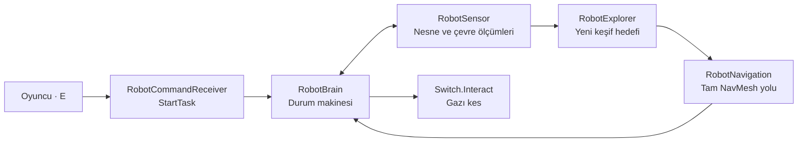
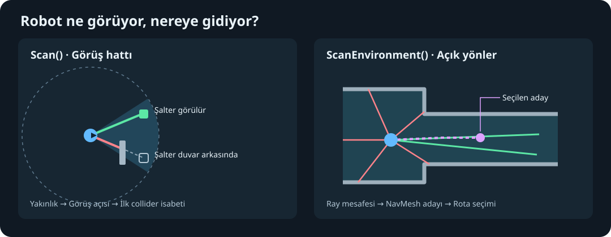
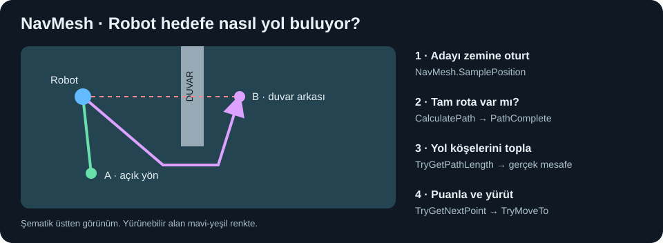
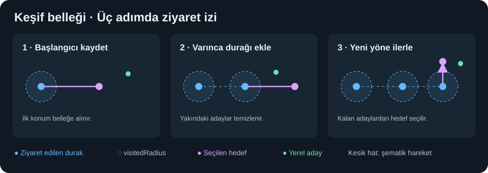

# Bakım robotu modülü

[README](../README.md) · [Robot kaynak klasörü](../Assets/_Project/Scripts/Robot/) · [Robot prefabı](../Assets/_Project/Prefabs/PF_Robot.prefab) · [Muhafız](muhafiz.md) · [Dünya ve oyun akışı](oyun-akisi.md)

Oyuncu robota gazı kesme görevi verir. Robot sensörlerinden bilgi toplar, keşif hedefi seçer ve NavMesh üzerinden hareket eder. Görev şalterin kapandığı doğrulandığında tamamlanır.

| Alt modül | Dosya ve fonksiyonlar | Neden ayrı? |
| --- | --- | --- |
| Komut | [RobotCommandReceiver](../Assets/_Project/Scripts/Robot/RobotCommandReceiver.cs) · `Interact()` | Oyuncu girdisini `DisableGas` görevine dönüştürür. |
| Karar | [RobotBrain](../Assets/_Project/Scripts/Robot/RobotBrain.cs) · `StartTask()`, `HandleSearching()`, `TryApproachVisibleSwitch()` | Şalter, normal kapı ve keşif kararlarının sırasını yönetir. |
| Algı | [RobotSensor](../Assets/_Project/Scripts/Robot/RobotSensor.cs) · `Scan()`, `ScanEnvironment()` | Fizik ölçümlerini üretir. [EnvironmentRayReading](../Assets/_Project/Scripts/Robot/EnvironmentRayReading.cs) tek ışının sonucunu taşır. |
| Keşif | [RobotExplorer](../Assets/_Project/Scripts/Robot/RobotExplorer.cs) · `TryGetNextPoint()`, `AddFrontier()`, `MarkVisited()` | Son taramayı ve önceki durakları kullanarak bir sonraki keşif noktasını seçer. |
| Hareket | [RobotNavigation](../Assets/_Project/Scripts/Robot/RobotNavigation.cs) · `CanReach()`, `TryGetPathLength()`, `TryMoveNear()`, `TryMoveTo()` | NavMesh sorgularını ve ajan hareketini kapsüller. |

## Nesne taraması

`Scan()` önce algılama katmanındaki collider'ları bir küre içinde toplar. Collider'ın üstünde `RobotDetectable` arar, tekrarları eler ve adayın robotun baktığı yöne olan açısını ölçer. Görüş açısı uygunsa collider merkezine ışın gönderir. İlk isabet aynı nesneyse hedef görünür kabul edilir. Görüş hattı uygun olsa bile yaklaşma yolunu NavMesh ayrıca doğrular.

## Keşif ve rota

`ScanEnvironment()` yatay düzlemde çevre ışınları atar. Her ışın yön, mesafe ve engel isabeti bilgisini taşır. `TryGetNextPoint()` isabet mesafesinden engel payını çıkarır ve hareketi keşif adımıyla sınırlar. Çok yakın noktaları eler. Kalanlar `NavMesh.SamplePosition` ile yürünebilir zemine alınır. Ziyaret edilmiş bölgelere yakın noktalar filtrelenir ve yakın adaylar birleştirilir.

`TryGetPathLength()` tam yolun köşeleri arasındaki mesafeleri toplar. Son taramadan gelen kısa rotalı yerel adaylar önce değerlendirilir. Yerelde ileri ilerleme, geçmiş adaylarda ziyaret edilen noktalarla uzaklık artı puan alır. Rota uzunluğu puanı azaltır. Böylece düz çizgide yakın görünen ancak dolaşma gerektiren bir noktanın maliyeti yüksek olabilir.

`TryMoveTo()` yolu ajana verir. `HasReachedDestination()` tam rota ve kalan mesafeyi kontrol eder. `MarkVisited()` varılan konumu kaydedip çevresindeki adayları temizler. Keşif yürüyüşünde robot yaklaşık 0,3 oyun saniyesinde bir şalteri tekrar arar. Görünür ve ulaşılabilir şalter bulursa keşif hedefini bırakıp şaltere yönelir.

## Ziyaret belleği

Mavi çemberler ziyaret durağının `visitedRadius` alanını gösterir. Ajan ilk konumu ve varılan durakları hatırlar. Şemadaki kesik hat hareket yönünü anlatır. `visitedPoints` sürekli kaydedilmiş bir rota yerine ayrık konumlar içerir.

Gerçek keşif karesi, durum diyagramı ve sayısal ölçümler [README robot bölümünde](../README.md#3-otonom-bakım-robotu).
